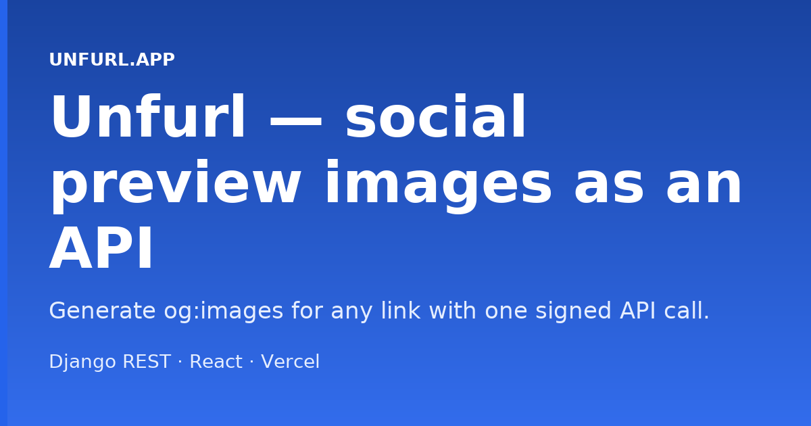
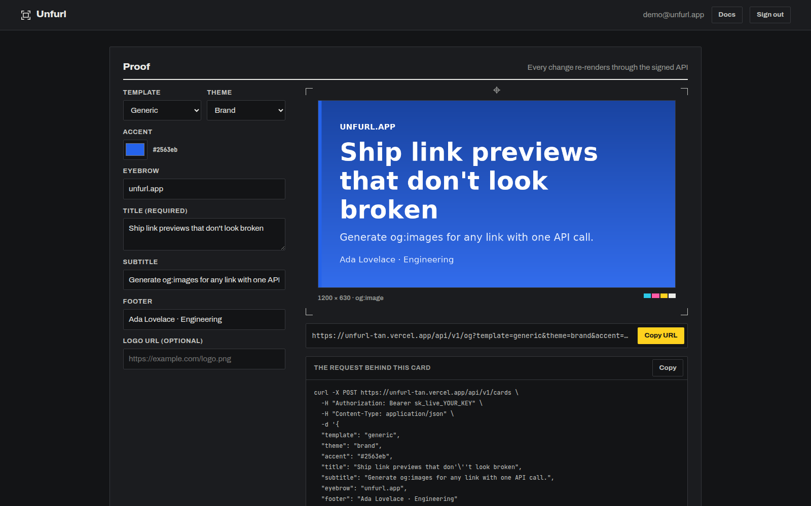

<h1 align="center">🖼️ Unfurl</h1>

<p align="center">
  <b>Social preview images as an API.</b><br/>
  Generate the <code>og:image</code> card for any link with one call: dynamic titles, themes and logos, signed and cached.
</p>

<p align="center">
  <a href="https://github.com/ahmad-zaman123/Unfurl/actions/workflows/ci.yml"></a>
  <a href="https://unfurl-one.vercel.app"></a>
  
  
  
  
  <a href="LICENSE"></a>
</p>

<p align="center">
  <a href="#-quick-start">Quick start</a> ·
  <a href="#-how-it-works">How it works</a> ·
  <a href="#-features">Features</a> ·
  <a href="#-api">API</a> ·
  <a href="#-limits">Limits</a> ·
  <a href="#-deployment--ci">Deployment</a>
</p>

<p align="center">
  
</p>

<p align="center">
  
</p>

---

## 🧭 What is Unfurl?

You authenticate once to **mint** a card, and get back a **signed public URL**. That URL goes straight into `<meta property="og:image">`: it needs no auth (crawlers can't send a token), it is tamper-proof, and it is cached after the first render.

The image itself isn't the interesting part. The platform around it is: hashed API keys, HMAC-signed URLs, per-key rate limiting, plan quotas, usage analytics and an SSRF-guarded image fetcher.

| 🎨 Create | 🔗 Serve | 📈 Observe |
|---|---|---|
| Authenticated `POST` with title, template, theme, accent and logo | Public, signed, cacheable image URL for any `og:image` tag | Per-key usage, rate-limit headers and monthly quota in a dashboard |

## 🚀 Quick start

**Prerequisites:** Python 3.11 and Node 20 (what CI uses). No Postgres or Redis needed locally: dev runs on SQLite and an in-memory cache.

**1. Backend** → `http://localhost:8010`

```bash
cd Backend
python3 -m venv .venv && source .venv/bin/activate
pip install -r requirements.txt
cp .env.example .env
python manage.py migrate
python scripts/seed_demo.py       # optional: demo account with keys and two weeks of usage
python manage.py runserver 8010
```

**2. Frontend** → `http://localhost:5175`

```bash
cd Frontend
npm install
cp .env.example .env              # VITE_API_URL=http://127.0.0.1:8010
npm run dev
```

<details>
<summary><b>🔧 Environment variables</b> (<code>Backend/.env</code>)</summary>
<br/>

| Key | Required | Notes |
|---|---|---|
| `SECRET_KEY` | **yes** | Django secret key. Use a long random string. |
| `DATABASE_URL` | no | Defaults to `sqlite:///db.sqlite3`. Production: a Neon Postgres URL. |
| `REDIS_URL` | prod | Rate-limit counters and the image cache. Empty means local memory, which is dev only. Format: `rediss://:<pass>@<host>:<port>`. |
| `CARD_SIGNING_SECRET` | recommended | Secret that signs public image URLs. Falls back to `SECRET_KEY`. |
| `UNFURL_PUBLIC_BASE_URL` | prod | Public origin used when building served image URLs. Defaults to the request host. |
| `CORS_ALLOWED_ORIGINS` | no | Comma-separated frontend origins. Defaults to the local Vite server. |
| `CSRF_TRUSTED_ORIGINS` | prod | Comma-separated, used by `config.settings.prod`. |
| `DEBUG` | no | `True` for local dev. |
| `GOOGLE_CLIENT_ID` | no | Turns on "Continue with Google" on the sign-in page. See **Google sign-in** below. |

Frontend: `VITE_API_URL` points at the backend; `VITE_GOOGLE_CLIENT_ID` is the same Google client id, only needed for the Google button.

</details>

<details>
<summary><b>🔑 Google sign-in</b> (optional, free)</summary>
<br/>

Adds a **Continue with Google** button to the sign-in page. First-time Google users get an account created from their Google email and name; existing accounts with the same email just sign in. Password sign-in keeps working as before, and a Google-created account can add a password later from the account menu.

1. In [Google Cloud Console → Credentials](https://console.cloud.google.com/apis/credentials) create an **OAuth client ID** of type **Web application**. If asked, set up the consent screen first (External, app name, your email; no extra scopes).
2. Under **Authorized JavaScript origins** add your frontend origins, for example `http://localhost:5173` and `https://<your-frontend>.vercel.app`. No redirect URI is needed.
3. Put the client ID in `GOOGLE_CLIENT_ID` (backend) **and** `VITE_GOOGLE_CLIENT_ID` (frontend) and redeploy both. There is no client secret in this flow: the backend verifies the Google ID token with Google's public keys and then issues the usual JWT pair from `POST /api/auth/google/`.

Leave both variables empty and the button is hidden.

</details>

<details>
<summary><b>🔑 Demo account</b> (live site)</summary>
<br/>

Sign in with **`demo@unfurl.app`** / **`demo1234`**. It is pre-loaded with API keys and two weeks of usage, so the analytics dashboard has data on first login.

</details>

## 🧩 How it works

```
 your server ── POST /api/v1/cards (Bearer sk_live_…) ──▶  Unfurl API
                                                              │ signs params (HMAC)
                ◀──────── { "url": ".../api/v1/og?…&sig=…" } ─┘

 <meta property="og:image" content=".../api/v1/og?…&sig=…">
        │
 crawler │  plain GET, no headers
        ▼
   /api/v1/og ──▶ verify signature ──▶ cache hit? ──▶ PNG (1200×630)
                       │ bad sig → 403        └─ miss → render with Pillow, store
```

A crawler fetching an `og:image` does a bare `GET` with no headers, so an authenticated "return a PNG" endpoint can't be used in a meta tag. Unfurl separates **create** (authenticated, mints a URL) from **serve** (public, cacheable), which is the only model that works.

## ✨ Features

<table>
<tr>
<td width="50%" valign="top">

### 🔏 HMAC-signed URLs
The served URL carries a signature over its parameters. Any unsigned or tampered request gets a `403`. The signature doubles as the cache key, so identical cards render once and then serve from cache (`X-Cache: HIT`).

### 🔑 API keys done like Stripe
Stored as a **SHA-256 hash** with only a display prefix (`sk_live_ab12…`). The raw key is shown exactly once. A custom DRF authentication class handles `Authorization: Bearer sk_…` and coexists with the dashboard's JWT.

### 📈 Usage analytics
A React dashboard shows total and daily calls, usage per key, cache stats and your monthly quota against your plan.

</td>
<td width="50%" valign="top">

### 🚦 Rate limits and quotas
Fixed-window limiter (atomic cache `incr`, Redis in prod) per key, returning `X-RateLimit-*` and `Retry-After`. A per-account monthly quota is enforced by plan. Only API-key traffic is metered, so dashboard previews stay unlimited.

### 🛡️ SSRF-guarded logo fetching
The `logo` parameter fetches a remote image. The fetcher resolves the host and rejects any non-public IP (loopback, private ranges, `169.254.x` cloud metadata), allows only `http(s)`, **refuses redirects** and caps size and time. A failed fetch just renders the card without a logo.

### 🎨 Templates and themes
Four templates and three themes, with a custom accent colour.

</td>
</tr>
</table>

## 🔌 API

Interactive docs at **`/api/docs/`** (Swagger) and a quickstart at **`/docs`** in the app.

```bash
curl -X POST https://<your-host>/api/v1/cards \
  -H "Authorization: Bearer sk_live_…" \
  -H "Content-Type: application/json" \
  -d '{"title": "Hello, world", "template": "article", "theme": "dark"}'
# → { "url": "https://<your-host>/api/v1/og?…&sig=…" }
```

Drop the returned `url` into `<meta property="og:image" content="…">`.

### Card parameters

| Field | Required | Values |
|---|---|---|
| `title` | **yes** | Up to 200 characters. Auto-sized, up to four lines. |
| `template` | no | `generic` (default), `article`, `product`, `event` |
| `theme` | no | `brand` (default), `light`, `dark` |
| `accent` | no | Hex colour such as `#2563eb` (default) |
| `subtitle` | no | Up to 200 characters |
| `eyebrow`, `footer`, `price`, `date`, `location` | no | Up to 120 characters each |
| `logo` | no | `http(s)` URL of a public image |

### Endpoints

| Endpoint | Auth | Purpose |
|---|---|---|
| `POST /api/v1/cards` | API key | Mint a signed card URL |
| `GET /api/v1/og` | none (signed URL) | Serve the image |
| `GET`, `POST /api/keys/` | JWT | List or create API keys |
| `DELETE /api/keys/<id>/` | JWT | Revoke a key |
| `GET /api/usage/` | JWT | Usage analytics |
| `POST /api/auth/register/`, `/auth/token/`, `/auth/token/refresh/`, `/auth/google/`, `/auth/password/`, `GET /auth/me/` | none / JWT | Accounts and sessions |

## 🚦 Limits

| Plan | Per minute | Per day | Per month |
|---|---|---|---|
| **Free** | 60 | 5,000 | 50,000 |
| **Pro** | 600 | 100,000 | 2,000,000 |

Per-minute and per-day limits apply per key. The monthly quota is summed across all of an account's keys.

## 🛠️ Tech stack

| Layer | Tech |
|---|---|
| **Backend** | Python 3.11, Django 4.2, Django REST Framework, Pillow, `simplejwt`, `drf-spectacular` |
| **Frontend** | React 19, Vite, React Router |
| **Data** | SQLite (local), Neon Postgres (prod), Redis via Upstash (prod cache and rate limits) |
| **Deployment** | Vercel (serverless Python + static React) |

## 🗂️ Project structure

```
Unfurl/
├── Backend/
│   ├── apps/
│   │   ├── cards/          renderer, signing, SSRF-safe fetch, cache
│   │   ├── apikeys/        key model, auth class, rate limiter
│   │   ├── users/          accounts, plans, JWT
│   │   └── core/           shared models
│   ├── config/settings/    base · dev · prod
│   └── scripts/seed_demo.py
├── Frontend/               dashboard, docs and landing pages
└── .github/workflows/      ci.yml · redis-keepalive.yml
```

## ☁️ Deployment & CI

- **Vercel**, with Neon Postgres and Upstash Redis. Set `REDIS_URL`, `DATABASE_URL`, `SECRET_KEY` and `CARD_SIGNING_SECRET` in production.
- **CI** (`ci.yml`) runs `manage.py check`, a missing-migrations check and the frontend build on every push and pull request.
- **Redis keep-alive** (`redis-keepalive.yml`) writes a key to Upstash every 7 days so the database doesn't sit idle. It needs a `REDIS_URL` repository secret.

## 📄 License

[MIT](LICENSE) © 2026 Ahmad Zaman
